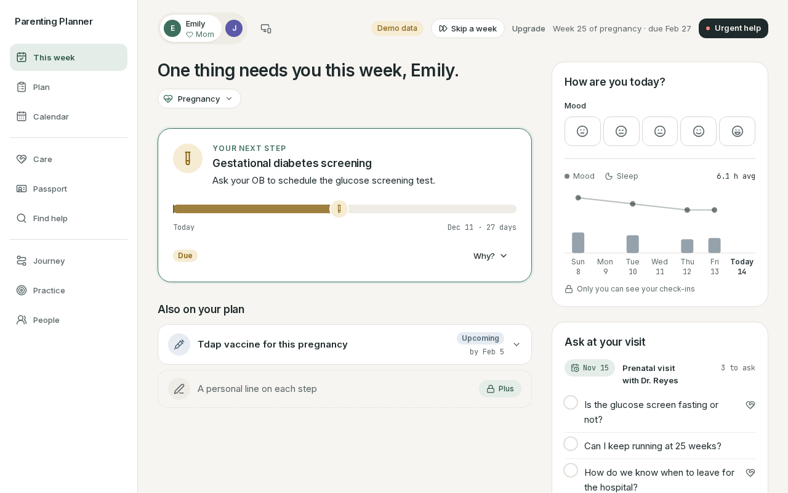
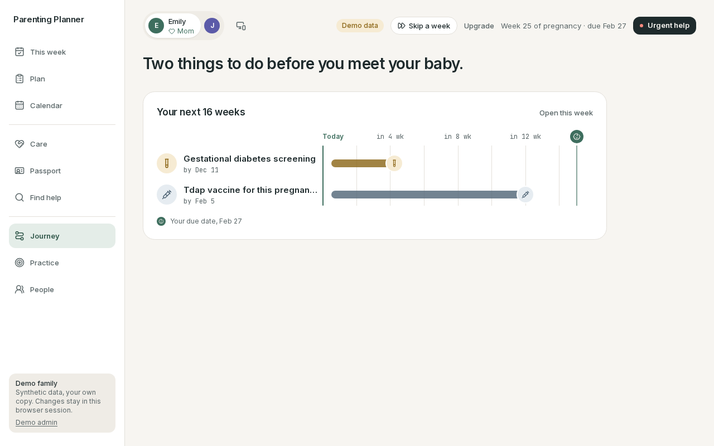

# Parenting Planner

A weekly plan for each parent, built from the family's own data and current health guidelines, from planning a pregnancy to age 9. Working name; the final product name is still open.

Built for Business Cup 2.0 by Zimran, Skills track.

**Live: https://parenting.unsoundmint.com** (no sign-up, no login)



## Try it in two minutes

1. Open the live link and press "Start the demo". You get your own copy of a synthetic family (Emily, 25 weeks pregnant, and her partner Jake). Today there is one family template.
2. On This week, read the next step and press "Why?" to see the reason and the source.
3. Log a mood check-in with the faces on the right. It is private to Emily.
4. Press "Skip a week" in the top bar. The family's demo clock moves forward seven days and the dates, due items and week of pregnancy are recomputed. Starting a new demo is the reset.
5. Switch roles with the Emily and J buttons at the top left. Jake has his own plan and cannot see Emily's check-ins. Grandparents and nannies are invited from People and see only the baby's care.
6. Open Plan, Journey, Care, Passport and Find help from the left menu. "Urgent help" in the top right is a fixed screen with hotlines.


## What is real and what is preview data

Real, computed from database state on every request:

- The demo family and its people, copied per visitor into Postgres, with dates relative to today.
- The rules engine in `api/internal/rules`: which steps are due, upcoming or overdue for each parent, with the reason and the source. Rules are pure functions with tests.
- Mood check-ins, who may read them, and the audit log of reads.

Preview data: screens whose endpoints are not built yet show typed sample data from `web/src/lib/mock` instead of being hidden, and the top bar says "Demo data". The sample data only fills in where the API answers 501, and in production it is off unless `NEXT_PUBLIC_PREVIEW_MOCKS=1` is set. Built and planned modules are listed in [docs/architecture.md](docs/architecture.md).

There is no AI model in this version. The plan comes from the rules engine alone. A language-model layer that ranks and explains the rule results is planned; it would never add medical actions the rules did not produce.



## Architecture

- `api/`: Go service (net/http, Postgres, sqlc, goose migrations).
- `api/openapi.yaml`: the only contract. The Go server interface and the TypeScript client are generated from it, and CI fails if generated code is stale.
- `web/`: Next.js 16 app. It calls the API from server components with the visitor's session cookie and never touches the database.
- `api/internal/rules` and `api/internal/access`: guideline rules, and who may read each sensitive record.
- Docker Compose behind Caddy in production; `main` deploys on every push.

Details: [docs/architecture.md](docs/architecture.md). Product scope: [docs/product.md](docs/product.md). How we work: [docs/workflow.md](docs/workflow.md).

## Run locally

Needs Go 1.26, Node 24 with pnpm, Docker, `make`, and a C compiler (sqlc builds with cgo: Xcode command line tools on macOS, `build-essential` on Linux, WSL on Windows).

```sh
(cd web && pnpm install)
make api     # Postgres in Docker + Go API on :8091
make web     # in another terminal: http://localhost:3000
make check   # generated code, Go tests, lint, typecheck, web build
```

No API keys are needed. The only optional setting is `SENTRY_DSN` for error reports.

## Dependencies and licences

| Part | Dependency | Licence |
| --- | --- | --- |
| Database | PostgreSQL 17 | PostgreSQL |
| API | pgx, goose, kin-openapi, oapi-codegen, sqlc | MIT, Apache-2.0 |
| API | google/uuid | BSD-3-Clause |
| API | sentry-go (error reports, personal data scrubbed) | MIT |
| Web | Next.js, React, Base UI, Tailwind CSS, Motion, Sonner, NumberFlow, openapi-fetch | MIT |
| Web | Lucide icons | ISC |
| Hosting | Caddy, Docker Compose | Apache-2.0 |

Exact versions are in `api/go.mod` and `web/pnpm-lock.yaml`. The repository does not have a licence file for our own code yet.

## Health guidance

This is a planning aid, not medical advice. It does not diagnose. Urgent symptoms and crisis paths are fixed screens with hotlines, never generated text. The demo families are synthetic and contain no real personal data.

Every rule carries a source (title and link) and the date it was checked, and the screen shows both under the item. Sources are CDC, ACOG, USPSTF, AAP and similar, collected in [docs/guidelines](docs/guidelines) with the conflicts between them. Evidence for the product itself is in [docs/research.md](docs/research.md).

## Team

Denis Andreyev (frontend), Sofia (backend), Dayana (product).
