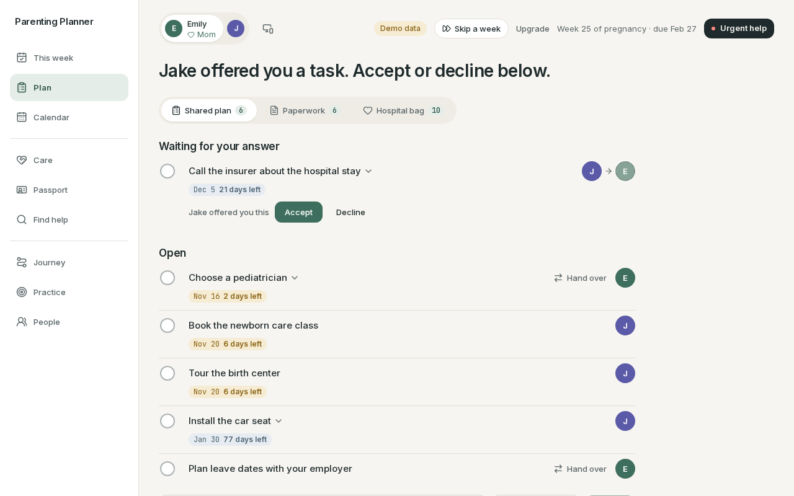

# Parenting Planner

A weekly plan for each parent, built from the family's own data and current health guidelines, from planning a pregnancy to age 9. Working name.

Built for Business Cup 2.0 by Zimran, Skills track.

**Live: https://parenting.unsoundmint.com** (no sign-up, no login)

## For the jury

The contest scores five questions. Where to look for each:

| Question | Short answer | Evidence |
| --- | --- | --- |
| Does it work? (40%) | Yes, on the live link, with no sign-up. Plans, rule results, check-ins, diaries, bookings and the practice rounds are computed from Postgres state, not hardcoded. | [Five-minute tour](#five-minute-tour), [what is real](#what-is-real-and-what-is-preview-data), [architecture](docs/architecture.md), `make check` in CI |
| What do we sell? (20%) | A weekly plan for each parent, built from the family's own data and current guidelines, plus practice rounds for the newborn skills. They return because the plan changes with the stage, the week and every check-in. | [docs/product.md](docs/product.md), the pricing page (Free and Plus, $14.99 a month or $119.99 a year) |
| Who do we sell to? (15%) | Working US couples, 25 to 45, expecting or raising a child up to age 9, who already pay for nannies, night nurses and sleep consultants. Both parents are users. | [docs/product.md](docs/product.md), pain points with sources in [docs/research.md](docs/research.md) |
| Why does it make money? (15%) | On Plus alone ($120 to $180 a year) $100M ARR is roughly 560k to 830k paying families, 15% to 23% of one year's US births, so the model depends on keeping families across the nine-year journey, with provider bookings as an unsized upside. | [docs/business-case.md](docs/business-case.md): price, lifetime value, acquisition ceiling, size. Sources in [docs/research.md](docs/research.md) |
| Is it new? (10%) | The closest whole-journey product we found is Maven Clinic, which is sold to employers and centered on women. The other products we checked cover one slice: sleep, development, play kits, a registry. | [docs/business-case.md](docs/business-case.md) and the competitor list in [docs/research.md](docs/research.md). Nanit, Tinyhood, Oath Care, Juniper and Mae are not checked yet. |

Track: Skills. The pain is that new parents learn newborn care and how to split it from reading, then meet the real night with no practice. The Learn section has paths, a practice simulator and a virtual baby.

### Five-minute tour

1. Open the live link. Four synthetic families are on the start page, each at a different stage. Pick one, for example "Leo is 7 weeks old". You get your own copy, so change whatever you like.
2. **This week**: read the next step and press "Why?" for the reason, written from this family's data. Sources are links inside the sentence.
3. Log a mood check-in with the faces. It is private to that parent.
4. Switch to the partner with the name switch at the top. They get a different plan from the same family, and cannot see the first parent's check-ins or diary. The window icon next to the switch opens the other parent in a second window.
5. **Learn**, then **Practice**: a short round of the newborn skills a parent will need.
6. **Plan**: Timeline, Calendar and Money and paperwork. **Health**: journal, check-ins, health records, Find help.
7. Press "Skip a week" in the top bar: the family's demo clock moves seven days and every due date and week of pregnancy is recomputed. Starting a new demo is the reset.
8. "Urgent help" at the top right is a fixed screen with hotlines, never generated text.
9. Pricing has Free and Plus. Upgrading starts a Stripe checkout in test mode: use the test card shown on the page, no real money moves.




## What is real and what is preview data

Real, computed from database state on every request:

- The demo families and their people, copied per visitor into Postgres, with dates relative to today.
- The rules engine in `api/internal/rules`: which steps are due, upcoming or overdue for each parent, with the reason and the source. Rules are pure functions with tests.
- Check-ins, diary, journal, calendar, bookings, shifts, tasks, health records, who may read each of them, and the audit log of reads.
- Every endpoint in `api/openapi.yaml` is implemented except the child passport, which still answers 501.

Preview data: a screen whose endpoint answers 501 shows typed sample data from `web/src/lib/mock` instead of being hidden, and the top bar says "Demo data". Production has this switched on, but it applies only to 501 answers, so today it affects the child passport card.

There is no AI in the plan. The weekly plan comes from the rules engine alone. The code has an optional layer that asks Claude to reword the plan, and a storybook that can use it too; both are off unless `ANTHROPIC_API_KEY` is set, check what comes back, and fall back to the rules and a template. We do not count on it for any claim above.


## Architecture

- `api/`: Go service (net/http, Postgres, sqlc, goose migrations).
- `api/openapi.yaml`: the only contract. The Go server interface and the TypeScript client are generated from it, and CI fails if generated code is stale.
- `web/`: Next.js 16 app. It calls the API from server components with the visitor's session cookie and never touches the database.
- `api/internal/rules` and `api/internal/access`: guideline rules, and who may read each sensitive record.
- Docker Compose behind Caddy in production; `main` deploys on every push.

Details: [docs/architecture.md](docs/architecture.md). Product scope: [docs/product.md](docs/product.md). How we work: [docs/workflow.md](docs/workflow.md).

## Run locally

Needs Go 1.26, Node 24 with pnpm, Docker, `make`, and a C compiler (sqlc builds with cgo: Xcode command line tools on macOS, `build-essential` on Linux, WSL on Windows).

```sh
(cd web && pnpm install)
make api     # Postgres in Docker + Go API on :8091
make web     # in another terminal: http://localhost:3000
make check   # generated code, Go tests, lint, typecheck, web build
```

No API keys are needed. The only optional setting is `SENTRY_DSN` for error reports.

## Dependencies and licences

| Part | Dependency | Licence |
| --- | --- | --- |
| Database | PostgreSQL 17 | PostgreSQL |
| API | pgx, goose, kin-openapi, oapi-codegen, sqlc | MIT, Apache-2.0 |
| API | google/uuid | BSD-3-Clause |
| API | sentry-go (error reports, personal data scrubbed) | MIT |
| Web | Next.js, React, Base UI, Tailwind CSS, Motion, Sonner, NumberFlow, openapi-fetch | MIT |
| Web | Lucide icons | ISC |
| Hosting | Caddy, Docker Compose | Apache-2.0 |

Exact versions are in `api/go.mod` and `web/pnpm-lock.yaml`. Our own code is under the MIT licence (`LICENSE`).

## Health guidance

This is a planning aid, not medical advice. It does not diagnose. Urgent symptoms and crisis paths are fixed screens with hotlines, never generated text. The demo families are synthetic and contain no real personal data.

Every rule carries a source (title and link) and the date it was checked in the rule data; the screen links the source inside the sentence. Sources are CDC, ACOG, USPSTF, AAP and similar, collected in [docs/guidelines](docs/guidelines) with the conflicts between them. Evidence for the product itself is in [docs/research.md](docs/research.md).

## Team

Denis Andreyev (frontend), Sofia (backend), Dayana (product).
