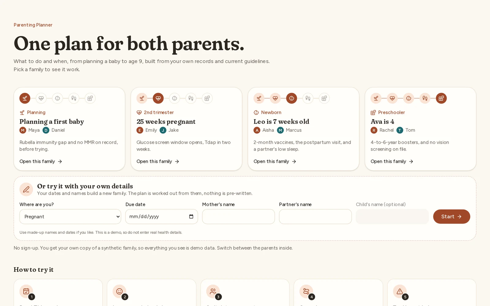
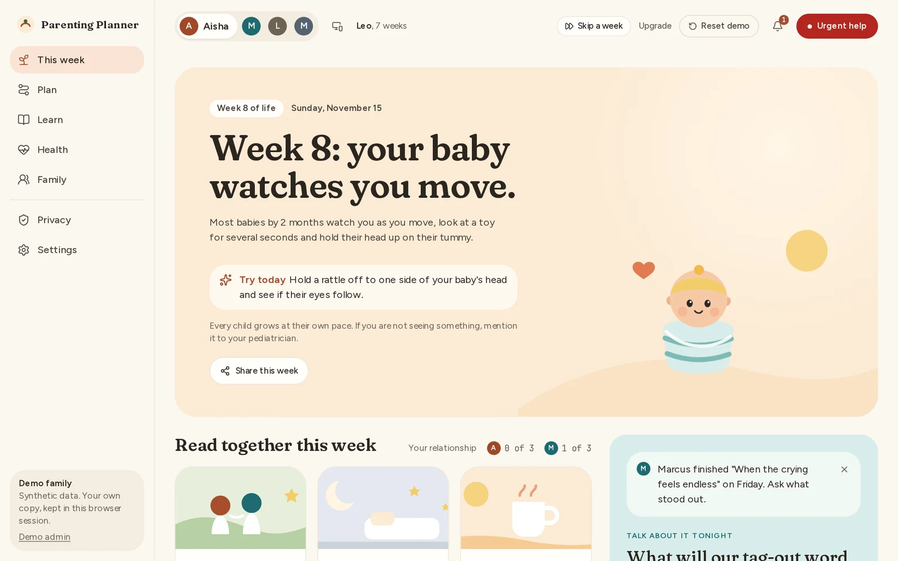
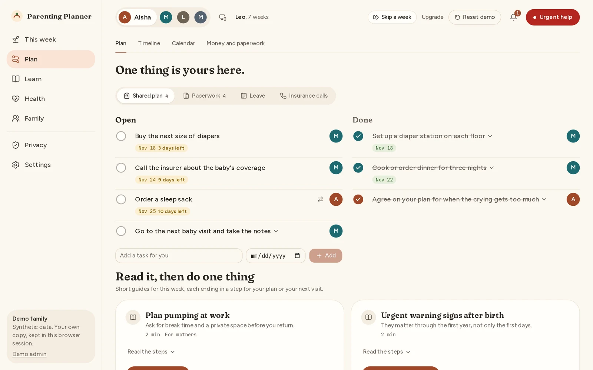
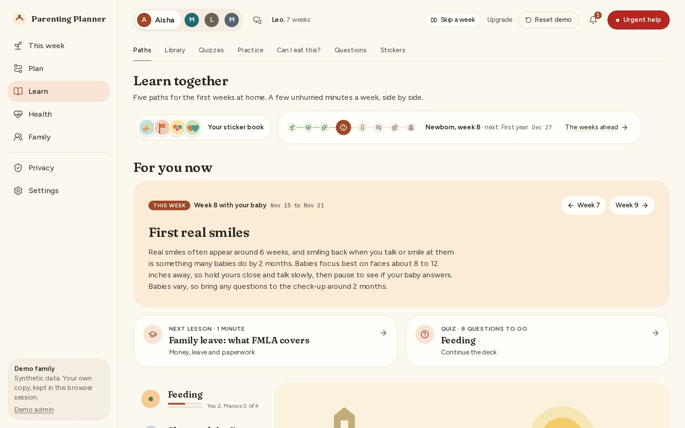
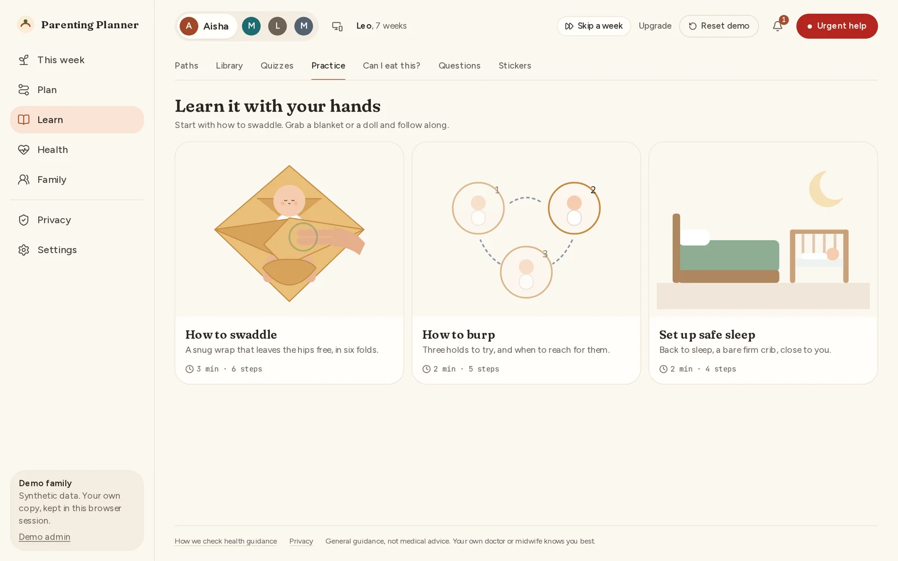
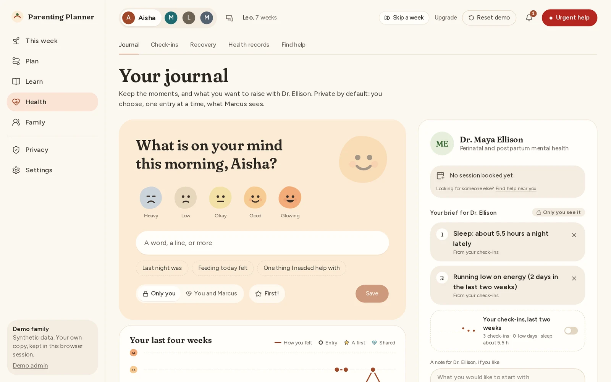

# Parenting Planner

Two parents, one plan. A weekly plan for each parent, worked out from the family's own records and current health guidelines, from planning a pregnancy to a child's ninth birthday.

Built in two days for Business Cup 2.0 (Zimran, Skills track) by a team of three. It did not reach the final. I now keep it as a portfolio piece: about 100k lines of Go and TypeScript, 207 merged pull requests, a rules engine with cited sources, and a live demo.

**Live demo: https://parenting.unsoundmint.com** (no sign-up, no login)



## What it does

- **This week.** The next step for each parent with a "Why?" written from that family's data. Sources are links inside the sentence.
- **Two parents, two views.** The partner gets a different plan from the same family. Check-ins and diary entries are private to their author unless shared one entry at a time.
- **Plan.** Shared tasks, paperwork, leave and insurance calls, a timeline of the next weeks, a calendar.
- **Learn.** Paths, a library, quizzes, and practice rounds for newborn skills such as swaddling, burping and safe sleep.
- **Health.** A journal, mood check-ins, a brief for the next appointment, health records, and a find-help directory.
- **Urgent help.** A fixed screen with hotlines. Crisis and urgent-symptom paths are never generated text.

| | |
| --- | --- |
|  |  |
|  |  |



## Engineering

The parts I care most about:

- **Rules are pure functions.** Which step is due, upcoming or overdue for a parent comes from `api/internal/rules`, with tests. Every rule carries a source and the date it was checked. There is no AI in the plan.
- **Privacy is enforced in one place.** `api/internal/access` decides who may read labs, diary, mood and session notes. The SQL filters mirror the Go functions and say so in a comment, and reads are written to an audit log.
- **One contract.** `api/openapi.yaml` is the only link between web and api. The Go server interface and the TypeScript client are generated from it, and CI fails if generated code is stale.
- **Real data, no hardcoding.** Each visitor gets their own seeded copy of a synthetic family in Postgres (httpOnly cookie, no auth). A "Skip a week" button moves that family's clock and every date is recomputed.
- **Unbuilt screens stay visible.** A screen whose endpoint answers 501 shows typed sample data from `web/src/lib/mock` and the top bar says "Demo data".
- **Small, merged-often PRs.** One issue, one branch, one PR, generated code checked in CI, goose migrations that run on API start.

## Stack

| Part | Technology |
| --- | --- |
| API | Go, net/http, pgx, sqlc, goose, oapi-codegen, kin-openapi |
| Database | PostgreSQL 17 |
| Web | Next.js 16 (Cache Components), React, TypeScript, Tailwind CSS, Base UI, Motion, Sonner, NumberFlow, Lucide |
| Contract | OpenAPI 3, generated Go server and TypeScript client |
| Deploy | Docker Compose behind Caddy, GitHub Actions |
| Payments | Stripe checkout in test mode |
| Monitoring | Sentry with personal data scrubbed |

Layout: `api/` Go service, `web/` Next.js app, `deploy/` Compose and Caddy, `docs/` product, research, architecture and design notes. Details are in [docs/architecture.md](docs/architecture.md).

## Run locally

Needs Go 1.26, Node 24 with pnpm, Docker, `make`, and a C compiler (sqlc builds with cgo).

```sh
(cd web && pnpm install)
make api     # Postgres in Docker + Go API on :8091
make web     # in another terminal: http://localhost:3000
make check   # generated code, Go tests, lint, typecheck, web build
```

No API keys are needed.

## Documentation

| Read | For |
| --- | --- |
| [docs/product.md](docs/product.md) | what we build and what we do not |
| [docs/business-case.md](docs/business-case.md) | price, lifetime value, market size, competitors |
| [docs/research.md](docs/research.md) | evidence and sources behind the product |
| [docs/guidelines](docs/guidelines) | health guideline sources and the conflicts between them |
| [docs/architecture.md](docs/architecture.md), [docs/data-model.md](docs/data-model.md) | how it is built |
| [docs/design.md](docs/design.md) | visual direction, tokens, motion |
| [docs/jury-guide.md](docs/jury-guide.md) | the contest scoring map and a five-minute tour |

## Health guidance

This is a planning aid, not medical advice. It does not diagnose. The demo families are synthetic and contain no real personal data. Sources are CDC, ACOG, USPSTF, AAP and similar.

## Team

Denis Andreyev (frontend, API contract), Sofia (backend, deploy), Dayana (product). MIT licence, see [LICENSE](LICENSE).
