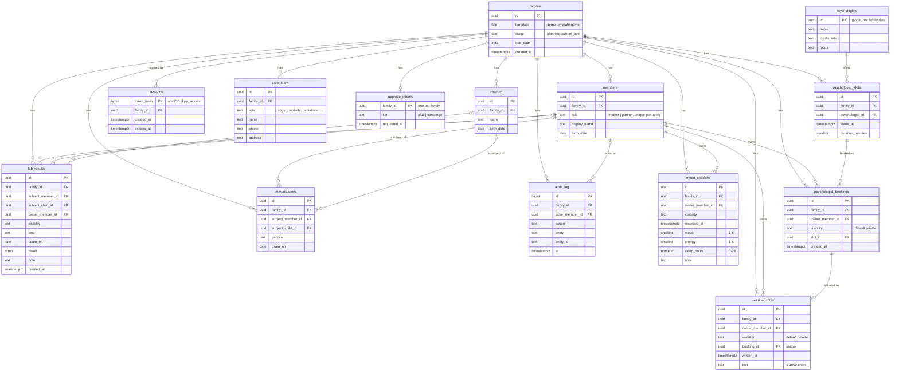

# Data model

Data model v1 (#80). It covers the 14 tables created by the migrations on `main` in `api/internal/store/migrations/`, plus the tables open PRs add. Snapshot as of 2026-11-14. When a migration lands, update this file in the same PR.

Conventions that hold for every table:

- **Family scope.** Every row belongs to one family (`family_id`, `ON DELETE CASCADE`). The only exceptions are global demo catalogues (`psychologists`, and `providers` in flight), which every session reads. Queries always filter by the session's family.
- **Sensitive records** have an `owner_member_id` and a `visibility` (`private`, `partner`, `care_team`, `family`). The read policy lives in `internal/access`, and list queries mirror it in SQL.
- **Audit.** Reads and writes of sensitive records add an `audit_log` row in the same transaction.
- **Subject.** A health record is about one parent or one child. `subject_member_id` and `subject_child_id` are both nullable, and a CHECK requires that exactly one is set.

## On main

## In flight (open PRs, not on main)

Migration numbers in these PRs are not final. Four PRs use `00003`, and each one is renumbered when it merges. Tables already on main appear here by name only. Columns added to them are listed below the diagram.

```mermaid
erDiagram
    families ||--o{ caregivers : "has (#346)"
    families ||--o{ invitations : "has (#346)"
    members ||--o{ invitations : "created_by (#346)"
    families ||--o{ tasks : "has (#258)"
    members ||--o{ tasks : "assignee (#258)"
    members |o--o{ tasks : "pending assignee (#258)"
    families ||--o{ diary_entries : "has (#202)"
    members ||--o{ diary_entries : "owns (#202)"
    providers ||--o{ booking_requests : "requested (#336)"
    families ||--o{ booking_requests : "has (#336)"
    members ||--o{ booking_requests : "owns (#336)"
    families ||--o{ vaccine_schedule : "has (#342)"
    families ||--o{ allergies : "has (#342)"
    members ||--o{ allergies : "owns (#342)"
    children ||--o{ growth_measurements : "measured (#342)"
    families ||--o{ bag_items : "has (#349)"
    members |o--o{ bag_items : "packer (#349)"
    families ||--o{ appointments : "has (#351)"
    appointments ||--o{ appointment_questions : "has (#351)"

    caregivers {
        uuid id PK
        uuid family_id FK
        text role "grandparent | nanny"
        text display_name
        text_array permissions "feeding, sleep, allergies, schedule, visits, milestones"
    }
    invitations {
        uuid id PK
        uuid family_id FK
        uuid created_by FK
        text role
        text display_name
        text_array permissions
        bytea token_hash "unique, sha256"
        timestamptz expires_at
        timestamptz accepted_at
        timestamptz revoked_at
    }
    tasks {
        uuid id PK
        uuid family_id FK
        text title
        date due_on
        uuid assignee_member_id FK
        uuid pending_assignee_member_id FK
        timestamptz created_at
    }
    diary_entries {
        uuid id PK
        uuid family_id FK
        uuid owner_member_id FK
        text visibility
        timestamptz written_at
        text body "1-5000 chars"
    }
    providers {
        uuid id PK "global, not family data"
        text name
        text type
        text city
        char2 state
        text_array languages
        smallint available_in_days
        integer price_usd
        text summary
    }
    booking_requests {
        uuid id PK
        uuid family_id FK
        uuid owner_member_id FK
        text visibility "default private"
        uuid provider_id FK
        text status "requested"
        text note
        timestamptz created_at
    }
    vaccine_schedule {
        uuid id PK
        uuid family_id FK
        uuid subject_member_id FK
        uuid subject_child_id FK
        text vaccine
        text dose
        date due_on
    }
    allergies {
        uuid id PK
        uuid family_id FK
        uuid subject_member_id FK
        uuid subject_child_id FK
        uuid owner_member_id FK
        text visibility
        text substance
        text certainty "suspected | confirmed"
        text reaction
        date noted_on
    }
    growth_measurements {
        uuid id PK
        uuid family_id FK
        uuid child_id FK
        date measured_on
        numeric weight_kg
        numeric height_cm
    }
    bag_items {
        uuid id PK
        uuid family_id FK
        text list "mother | baby | partner"
        text label
        uuid packer_member_id FK
        boolean packed
    }
    appointments {
        uuid id PK
        uuid family_id FK
        text with_name
        timestamptz starts_at
    }
    appointment_questions {
        uuid id PK
        uuid family_id FK
        uuid appointment_id FK
        text body
        boolean answered
        timestamptz created_at
    }
```

Columns added to tables already on main:

- #342 adds `lab_results`: `name`, `value`, `unit`, `ref_low`, `ref_high` (one measured value per row). It adds `immunizations.dose`, and `care_team`: `clinic`, `subject_member_id`, `subject_child_id`.
- #346 adds `caregivers.permissions`. #341 creates `caregivers` without that column and is superseded by #346.
- #228 is a draft duplicate of #258 (`tasks`) and is not shown.

## Tables

| Table | Owner / scope | Visibility, audit | Used by |
| --- | --- | --- | --- |
| `families` | Root of a demo copy. `template` names the seed, `stage` drives the rules. | n/a | `GET /family`, `internal/plan`; every screen. `PATCH /members/{id}/family` and `POST .../baby-arrival` are stubs. |
| `members` | Parents only. `role` is `mother` or `partner`, unique per family. | n/a | `GET /family`; the `/family` picker and every `/members/{memberId}/...` path. |
| `children` | Family | n/a | `GET /family`. `GET .../children/{childId}/passport` is a stub. |
| `sessions` | Family. Stores only the sha256 of the cookie. | n/a | `POST /demo/sessions`; resolves every request. |
| `care_team` | Family. No owner yet; #342 adds a subject. | none | Plan facts. `GET .../passport` is a stub on main and becomes real in #342. |
| `lab_results` | Owner plus a subject (parent or child) | `visibility`. Plan reads are filtered by `internal/access` but not audited. | `internal/plan` (rules), Passport (#342) |
| `immunizations` | Subject only. No owner. | none | Plan facts (vaccine rules), Passport (#342) |
| `audit_log` | Family; actor is a member | It is the audit. | Written by `wellbeing` and `care`. `GET .../access-log` is a stub. |
| `mood_checkins` | Owner | `visibility`, audited on read and write | Home: mood check-in card, sleep chart, `GET/POST .../mood-checkins`, `GET .../mood-patterns`; plan facts |
| `upgrade_intents` | One row per family | n/a | Pricing: `POST /family/upgrade-intents` |
| `psychologists` | Global demo row | n/a | Care screen |
| `psychologist_slots` | Family. No owner until booked. | n/a | Care: `GET .../psychologist-slots` |
| `psychologist_bookings` | Owner | Always `private`, audited | Care: `POST .../psychologist-bookings`, `GET .../psychologist-agenda`; plan facts |
| `session_notes` | Owner | Always `private`, audited | Care: `POST .../session-notes`, agenda |
| `caregivers` (#346) | Family. Separate from `members`, so parent-only queries stay parent-only. | `permissions` set by the parents. No rows in sensitive tables. | Caregiver home, invitations |
| `invitations` (#346) | Created by a parent. Token stored as a hash. | n/a | `.../invitations`, `/invitations/{token}` |
| `tasks` (#258) | Family-wide. One assignee, plus a pending assignee until accepted. | none (deliberately not private) | `.../tasks`, reassignment accept/decline |
| `diary_entries` (#202) | Owner | `visibility` per entry | Diary, psychologist agenda |
| `providers` (#336) | Global demo catalogue | n/a | Directory: `GET /providers` |
| `booking_requests` (#336) | Owner | Always `private` | Directory: `.../booking-requests` |
| `vaccine_schedule` (#342) | Subject only | none | Passport vaccine timeline |
| `allergies` (#342) | Owner plus subject | `visibility` | Passport allergies card |
| `growth_measurements` (#342) | Child | none | Passport growth card |
| `bag_items` (#349) | Family; optional packer | none | Hospital bag lists |
| `appointments`, `appointment_questions` (#351) | Family | none | `.../appointment-questions`, carry-over to the next visit |

Health data stored without an owner or visibility column: `immunizations`, and in flight `vaccine_schedule`, `growth_measurements` and `appointment_questions`. Today these are readable by both parents. This is recorded here only. Any change belongs in a separate issue.

## Screen coverage

Screens come from `docs/demo-script.md`, the pages in `web/src/app/`, and the contract. Status: **main** means the tables exist on main; **#N** means they arrive with that PR; **none** means no PR adds a table yet.

| Screen | Tables | Endpoints | Status |
| --- | --- | --- | --- |
| Landing, pick a demo family (`/`) | `families`, `members`, `children`, `sessions` | `POST /demo/sessions` | main |
| Person picker (`/family`) | `families`, `members`, `children` | `GET /family` | main |
| Home: plan and "what is due" (`/family/[memberId]`) | rules over `families`, `members`, `lab_results`, `immunizations`, `care_team`, `mood_checkins`, `psychologist_bookings`, `session_notes` | `GET .../plan` | main (plan items computed, not stored) |
| Home: mark a plan item booked | none | `POST .../plan/{ruleId}/status` (stub) | none |
| Home: AI weekly plan | none (computed on top of the plan) | `GET .../weekly-plan` (stub) | none |
| Home: mood check-in, patterns, sleep | `mood_checkins` | `.../mood-checkins`, `.../mood-patterns` | main |
| Today, live updates | reads other tables | `GET .../today`, `GET .../live` (stubs) | none needed beyond the tables they summarize |
| Journey (`/journey`) | `families.stage`, plan | `GET /family`, `GET .../plan` | main |
| Stage guides, pregnancy week cards | static content in Go (not built) | `.../guides`, `.../pregnancy-weeks/{week}` (stubs) | none expected |
| Stage change, baby arrival | `families`, `children` | `PATCH .../family`, `POST .../baby-arrival` (stubs) | main (tables exist) |
| Care: psychologist slots, booking, agenda, notes (`/care`) | `psychologists`, `psychologist_slots`, `psychologist_bookings`, `session_notes` (+ `diary_entries` for the agenda) | `.../psychologist-*`, `.../session-notes` | main; diary topics #202 |
| Diary with per-entry sharing | `diary_entries` | in #202 | #202 |
| Directory and booking requests (`/directory`) | `providers`, `booking_requests` | `GET /providers`, `.../booking-requests` (stubs on main) | #336 |
| Health passport (`/passport`) | `lab_results`, `immunizations`, `vaccine_schedule`, `allergies`, `growth_measurements`, `care_team` | `GET .../passport` (stub on main) | #342 |
| Child passport | same, child subject | `GET .../children/{childId}/passport` (stub) | #342 (tables) |
| Family tasks and reassignment | `tasks` | `.../tasks...` (stubs on main) | #258 |
| Invitations, caregivers, caregiver home | `caregivers`, `invitations` | `.../invitations...`, `/invitations/{token}...` (stubs on main) | #346 |
| Access log ("who saw what") | `audit_log` | `GET .../access-log` (stub) | main (table exists) |
| Calendar events | none | `.../calendar-events` (stubs) | none |
| Appointment questions | `appointments`, `appointment_questions` | `.../appointment-questions` (stubs on main) | #351 |
| Hospital bag | `bag_items` | added in #349 | #349 |
| Night shifts | none | `.../shifts` (stubs) | none |
| Care log and handoffs | none | `.../care-log`, `.../handoffs` (stubs) | none |
| Simulator (scenarios, practice rounds) | none | `.../simulator`, `.../simulator-rounds...` (stubs) | none |
| Pricing (`/pricing`) | `upgrade_intents` | `POST /family/upgrade-intents` | main |
| Checkout (Stripe test mode) | none | `.../checkout-sessions...`, `/billing/stripe-webhook` (stubs) | none |
| Help, crisis button (`/help`) | none (fixed content, no AI) | none | no table needed |

## Issue entities vs today

| Entity in #80 | How it is represented | Gap |
| --- | --- | --- |
| Family | `families` | None. `template` and `stage` live on the row. |
| Member | `members` (parents only). Non-parent helpers are `caregivers` (#346). | No unified "person". Caregivers are kept separate on purpose, so they can never own sensitive rows. |
| Role | `members.role` (`mother`, `partner`), `care_team.role` (professional kind), `caregivers.role` (`grandparent`, `nanny`, #346). Caregiver permissions are a `text[]` (#346). | No `roles` table. Roles are CHECK enums, and permissions exist only for caregivers. |
| Stage | `families.stage` CHECK enum (`planning` .. `school_age`). Stage groups such as `perinatalStages` are in Go (`internal/rules`). | Per family, not per child. No stage history. Stage change and baby arrival are stubs. |
| PlanItem | Not stored. `rules.Plan` computes `rules.Item` (status, due, reason, source) from the data on each request. The closest stored to-do is `tasks` (#258). | Progress on an item ("booked", "done") has no table, so `POST .../plan/{ruleId}/status` is a stub. That needs a `plan_item_progress` row keyed by family, member and rule id. |
| Template | `families.template` text, filled from the Go `demo.Template` constants (`pregnancy`, `planning`, `newborn`, `preschool`) in `internal/demo`. | No `templates` table. Seeds are Go code, which keeps their dates relative to today. |
| Visibility | A `visibility` column with a CHECK on `lab_results`, `mood_checkins`, `psychologist_bookings`, `session_notes`, and in flight `diary_entries`, `allergies` and `booking_requests`. The policy is in `internal/access`, mirrored in SQL. | The `care_team` level is stored but has no viewer yet, since professionals cannot log in. Some health tables have no visibility (see above). |
